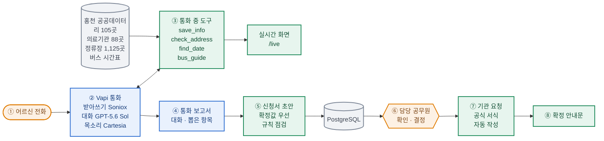
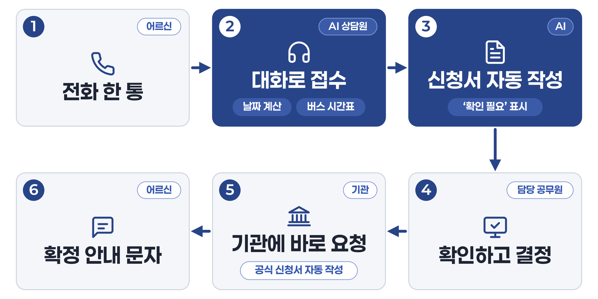
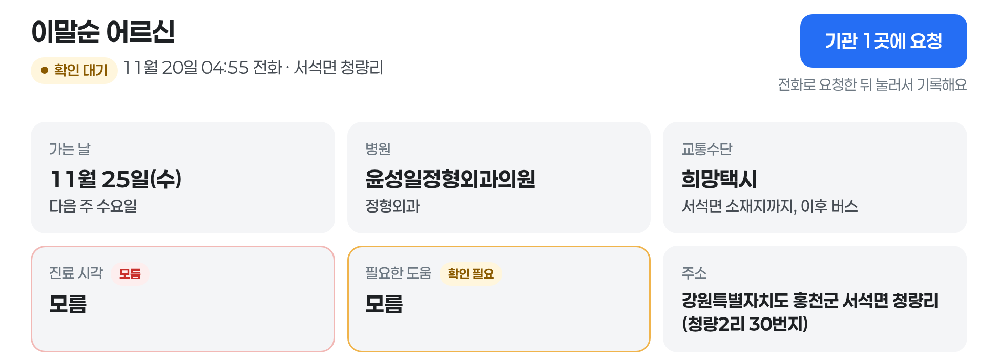
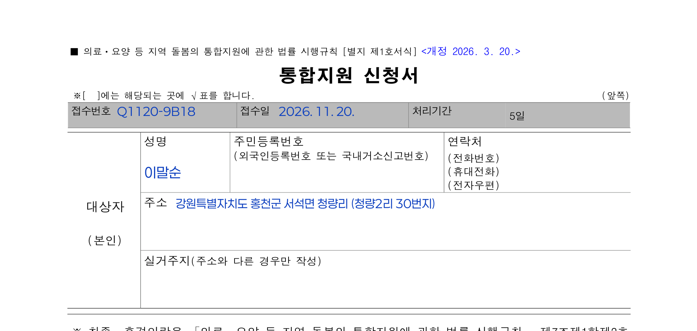

<div align="center">

<picture>
  <source media="(prefers-color-scheme: dark)" srcset="docs/banner-dark.png">
  
</picture>

### 어르신 병원 가는 날, 전화 한 통으로 신청하는 AI 상담원

**강원 홍천군 어르신이 전화로 병원 가는 날을 말씀하시면, AI 상담원이 대화로 받아 신청서 초안과 공식 서식을 만들고, 읍·면 담당 공무원이 확인해 기관에 요청합니다.**

[](#개발-기간)
[](https://www.python.org/)
[](https://fastapi.tiangolo.com/)
[](https://vapi.ai/)
[](#사용한-모델라이브러리데이터-출처)
[](#사용한-모델라이브러리데이터-출처)
[](tests/)
[](#평가)

[왜 한 통이면 돼유](#왜-한-통이면-돼유) · [기능](#기능) · [구조도](#구조도) · [화면](#화면) · [설치](#설치) · [빠른 시작](#빠른-시작) · [평가](#평가) · [데모](#데모) · [로드맵](#로드맵) · [출처](#사용한-모델라이브러리데이터-출처)

</div>

---

**한 통이면 돼유**는 강원 홍천군 어르신이 병원 가는 날을 전화 한 통으로 신청하는 서비스입니다. AI 상담원이 대화로 성함 · 주소 · 병원 · 날짜 · 동행 · 교통편을 받고, 통화가 끝나면 신청서 초안과 기관에 낼 공식 서식을 만듭니다. 읍·면 담당 공무원은 대시보드에서 확인하고 결정만 합니다.

AI는 받아 적고 초안을 만드는 일만 합니다. 주소 · 병원 · 날짜는 통화 중에 서버가 홍천 공공데이터와 규칙으로 확인하고, 어르신이 말씀하지 않은 칸은 지어내지 않고 '확인 필요'로 남깁니다. 결정은 담당 공무원이 합니다.

> 시연과 평가는 가상 어르신 자료로만 했습니다. 실제 주민 개인정보는 쓰지 않습니다.

## 왜 한 통이면 돼유

- **어르신**: 병원 한 번 가려면 이장님(희망택시) · 노인복지관(병원동행) · 버스 시간표 · 읍·면사무소 네 군데에 따로 연락해야 합니다. 읍·면 어르신 4명 중 1명은 병원까지 걸어서 1시간이 넘고, 4명 중 1명은 스마트폰이 없습니다(보건복지부 2023 노인실태조사).
- **담당 공무원**: 2026년 3월 통합돌봄 시행으로 신청 접수가 읍·면·동으로 왔지만, 읍·면·동 통합돌봄 담당자 100명 중 97명은 다른 일과 겸직합니다(보건복지부 통합돌봄 인력배치 현황, 2026-07-31 기준).

| | 전화만으로 이용 | 교통 연결 | 동행 연결 | 담당자 승인 · 기록 | 강원 군 지역 |
|---|:-:|:-:|:-:|:-:|:-:|
| **한 통이면 돼유** | **O** | **O** | **O** | **O** | **O** |
| AI 안부전화 (케어콜) | O | X | X | △ | △ |
| 동행콜택시 (서울 120) | O | O | X | X | X |
| AI 교통 실증 (농식품부 · 인제) | O | O | X | X | △ |
| 병원동행 (노인복지관) | O | X | O | X | O |

<sub>△는 일부만(일부 군에서 운영 · 한 곳에서 시범). 출처: 네이버 케어콜 보도자료, 홍천 · 정선 AI 케어콜 보도, 서울시 120 동행콜택시 안내, 농림축산식품부 보도자료(2026-07-26), 홍천군노인복지관 병원동행 안내.</sub>

## 기능

- **전화 한 통 접수**: 시연용 전화번호(+1 346-372-7261, Vapi의 미국 번호)나 웹 통화(`/call`, QR)로 겁니다. 강원 사투리 말끝은 표준어 뜻으로 알아듣습니다.
- **통화 중 확인 (도구 4개)**: AI 상담원이 통화 중에 서버 도구를 부릅니다.
  - `save_info`: 들은 값(성함 · 주소 · 병원 · 날짜 · 시각 · 동행 · 휠체어 · 버스 · 모시러 갈 곳)을 확인해 저장하고, 되읽을 말과 아직 모르는 것을 돌려줍니다.
  - `check_address`: 주소가 홍천군 리 105곳에 있는지, 다른 면의 리는 아닌지 맞춰 봅니다. 마을 번호는 "청량이리, 숫자 둘"처럼 소리 나는 대로 되읽게 합니다.
  - `find_date`: "다음 주 금요일"을 날짜로 바꾸고 공휴일 · 주말 · 병원동행 7일 전 예약 규칙을 알려 줍니다.
  - `bus_guide`: 마을에서 가까운 정류장과 진료 시각에 맞는 버스를 홍천군 공식 시간표로 찾습니다.
- **실시간 화면 (`/live`)**: 통화 내용과 '확인된 것'을 실시간으로 보여 줍니다. 통화가 끝나고 담당자에게 전달되면 5초 뒤 대기 화면으로 돌아갑니다.
- **신청서 초안**: 통화가 끝나면 Vapi가 뽑은 항목에 통화 중 확정값을 덮어써 초안을 만들고, 진료시간 · 주말 · 7일 전 예약 · 희망택시 운행 마을을 규칙으로 점검합니다.
- **담당 공무원 화면 (`/`)**: 신청을 보고 병원을 고르고, 기관에 요청하고, 기관 응답과 처리 이력을 남깁니다.
- **공식 서식 자동 작성**: 통합지원 신청서(법령 별지 제1호서식)와 특별교통수단 등록신청서(홍천군 조례 서식)를 PDF · Word로 채웁니다.
- **확정 안내문**: 병원 근처 약국까지 넣어 안내문을 씁니다. 시연에서는 발송 기록만 남기고, 실제 문자 발송은 연결하지 않았습니다.

## 구조도



<sub>색: 주황 사람 · 파랑 AI(Vapi) · 초록 이 레포의 서버(규칙) · 회색 데이터.</sub>



<sub>서비스 흐름. 어르신은 전화 한 통만 하고, 담당 공무원은 AI가 채운 신청서를 확인하고 결정만 합니다.</sub>

| 곳 | 하는 일 |
|---|---|
| Vapi | 전화를 받고 받아쓰기(Soniox v6) → 대화(GPT-5.6 Sol) → 목소리(Cartesia Sonic 3.5)를 잇습니다. 통화 중 서버 도구를 부르고, 통화가 끝나면 보고서를 보냅니다. |
| Railway | 이 레포의 서버(FastAPI)와 PostgreSQL을 돌립니다. GitHub `main`에 올리면 새로 띄웁니다. |
| PostgreSQL | 신청서를 저장합니다. 통화 1건이 1줄이고, 대화 기록 · 확인된 값 · 처리 상태 · 이력이 들어갑니다. |
| 서버 메모리 | 홍천 공공데이터 CSV(서버가 켜질 때 읽음)와 통화 중 확정값 · 실시간 대화(다시 켜면 비워짐). |

## 화면



<sub>담당 공무원 화면. AI가 채운 칸과 '모름' · '확인 필요' 칸을 나눠 보여 줍니다(가상 어르신).</sub>



<sub>자동으로 채운 통합지원 신청서(「의료·요양 등 지역 돌봄의 통합지원에 관한 법률 시행규칙」 별지 제1호서식, 가상 어르신).</sub>

## 설치

파이썬 3.11이 필요합니다.

```bash
git clone https://github.com/mself8/hantong.git
cd hantong
python -m venv .venv && source .venv/bin/activate
pip install -r requirements.txt
cp .env.example .env   # 쓰는 기능의 값만 채웁니다
```

## 빠른 시작

```bash
uvicorn app.main:app --reload   # http://127.0.0.1:8000
pytest                          # 서버 시험 91개
```

- `/` 담당 공무원 화면 · `/live` 실시간 화면 · `/call` 웹 통화 · `/view` 읽기 전용 확인 화면 · `/docs` API
- `DATABASE_URL`을 비우면 로컬 SQLite(`hantong.db`)를 씁니다. Railway에서는 Postgres를 붙이면 자동으로 채워집니다.
- 실제 통화에는 Vapi 어시스턴트가 필요합니다. 지시문은 `vapi/assistant_prompt.md`, 통화 뒤 항목 뽑기는 `vapi/structured_output.json`입니다. 서버 주소는 도구 `/vapi/tools`, 통화 보고서 `/vapi/webhook`이고, 비밀값은 `VAPI_SECRET`으로 맞춥니다. 웹 통화 화면에는 `VAPI_PUBLIC_KEY`가 필요합니다.
- `KAKAO_REST_KEY`가 있으면 모시러 갈 곳을 카카오맵 주소로 찾고, 없으면 건너뜁니다.
- `ANTHROPIC_API_KEY`는 Vapi가 뽑은 항목이 오지 않았을 때만 쓰는 예비 정리용입니다.

## 평가

- **가상 통화 글 180건** (`eval/text_eval.py`): 팀원이 만든 시험 카드 60장마다 말하는 방식이 다른 대화 3개입니다(한 번에 다 말하기 · 조금씩 말하기 · 말 바꾸기 · 되묻기 · 딴 얘기 섞기 · 애매하게 말하기 · 모른다고 하기). 신청서 항목(병원 · 날짜 · 시간 · 동행 · 마을)을 채점합니다.
  - 규칙 방식: 모든 항목이 맞은 비율(JGA)이 0.511이었고, 이 자료를 보며 날짜 · 병원 맞추기 규칙을 고친 뒤 1.0이 됐습니다(`eval/results/rules_요약_수정전.json` → `rules_요약.json`).
  - LLM 방식: 로컬 Qwen3.8-27B가 대화에서 항목을 뽑고 서버 규칙을 거쳐 JGA 1.0, 카드마다 세 대화가 모두 맞은 비율(pass^3) 1.0입니다(`eval/results/llm_요약.json`). 시연 모델(GPT-5.6 Sol)과는 다른 모델입니다.
- **음성 시험** (`eval/voice_eval.py`): 팀원이 시험 카드(`/call/cards`)를 보고 실제로 건 통화를 카드 정답과 비교합니다. '내일' 같은 상대 날짜는 건 날 기준으로 서버와 따로 계산합니다.
- **서버 시험 91개** (`tests/`): 주소 확인, 저장 도구, 버스 안내, 날짜 규칙, 실시간 화면 정리, API 흐름.

## 데모

- 시연 주소(대회 기간 운영, 서버 · 통화 비용이 끊기면 닫힐 수 있습니다)
  - 실시간 화면: https://hantong-production.up.railway.app/live
  - 담당 공무원 화면: https://hantong-production.up.railway.app/
  - 웹 통화: https://hantong-production.up.railway.app/call
- 발표자료: 대회 제출물(PPT)

## 로드맵

- **국내 전화번호**: 지금은 Vapi의 미국 번호입니다. 통신사 회선(070 · 1588)을 연결합니다.
- **문자 발송**: 확정 안내문을 실제 문자로 보냅니다. 지금은 발송 기록만 남깁니다.
- **가까운 병원 찾기**: 리 좌표와 의료기관 88곳으로 진료과별 가장 가까운 곳을 찾는 도구를 더합니다.
- **지자체 내부 모델**: 신청서 정리 모델은 기관 내부의 오픈 모델로 바꿀 수 있게 나눠 두었습니다. 대화 모델까지 내부로 옮기는 방안을 검토합니다.
- **강원 다른 군으로 확대**: 마을 · 버스 · 병원 자료 파일을 더합니다.

## 폴더 구조

```
app/                서버 (FastAPI)
  main.py           주소: 통화 중 도구(/vapi/tools) · 통화 보고서(/vapi/webhook) · 실시간 화면 · 대시보드 API
  slots.py          통화 중 확정값 저장 (save_info)
  address.py        주소 확인 (홍천군 리 목록과 대조)
  bus.py            버스 정류장 · 시간표 안내
  live.py           실시간 화면용 대화 저장
  pipeline.py       통화 보고서 → 신청서 초안
  normalize.py      날짜 · 시간 · 병원 · 마을 표현을 실제 값에 맞추기
  validate.py       규칙 점검
  workflow.py       기관 요청 · 확정 안내문
  pdfforms.py       공식 서식 PDF 채우기 (wordforms.py는 Word)
  store.py          신청서 저장소 (Railway Postgres · 로컬 SQLite)
  extract.py        예비 정리 (Claude)
  kakao.py          카카오 주소 검색
  data.py           data/ 읽기
  forms/            공식 서식 원본 (출처는 forms/README.md)
  static/           웹 통화 · 실시간 화면 (call.html)
dashboard/dist/     담당 공무원 화면
vapi/               Vapi 지시문 · 구조화 출력
data/               홍천 공공데이터 · 가상 데이터 (data/SOURCES.md)
eval/               평가: 가상 통화 글 · 음성 시험
tests/              서버 시험 (pytest)
scripts/            README 배너 만들기
docs/               신청서 형식 · API 문서, README 그림
```

## 개발 기간

본선 기간(2026-11-19 ~ 11-20)에 개발했습니다. 첫 커밋은 2026-11-19 15:06(한국 시각)입니다.

## 팀

m-M-m: 이종현(서비스 기획) · 장다연(개발 · 테스트) · 정송윤(개발 총괄) · 김고은(BM 설계)

## 사용한 모델·라이브러리·데이터 출처

- 통화 플랫폼: Vapi (https://vapi.ai) — 전화번호 · 웹 통화, 말 끝 감지, 통화 중 도구 호출, 통화 뒤 구조화 출력(`vapi/structured_output.json`). 웹 통화 화면은 `@vapi-ai/web` 3.1.0(esm.sh · jsDelivr)
- 받아쓰기(STT): Soniox v6, 한국어 (Vapi 연결)
- 대화 모델(LLM): OpenAI GPT-5.6 Sol (Vapi 연결). 지시문 `vapi/assistant_prompt.md`
- 목소리(TTS): Cartesia Sonic 3.5, 'Hyerin graceful host' 목소리 (Vapi 연결)
- 예비 정리: Anthropic Claude (`claude-opus-5-5`, `EXTRACT_MODEL`로 바꿀 수 있음). Vapi가 뽑은 항목이 없을 때만 씁니다
- 평가 LLM: Qwen3.8-27B (OpenAI 호환 주소로 부른 로컬 모델, `eval/text_eval.py --model`)
- 주소 검색: 카카오 로컬 API (`KAKAO_REST_KEY`)
- 서버 · 데이터베이스: Railway (FastAPI 서버, PostgreSQL)
- 라이브러리: FastAPI 0.162.5 (MIT), Uvicorn 0.54.0 (BSD-3-Clause), Pydantic 2.14.3 (MIT), SQLAlchemy 2.0.58 (MIT), psycopg 3.3.9 (LGPL-3.0), Anthropic Python SDK 2.10.0 (MIT), HTTPX 0.28.1 (BSD-3-Clause), python-dotenv 1.2.4 (BSD-3-Clause), PyMuPDF 1.28.2 (AGPL-3.0, 공식 서식 PDF 채우기), python-docx 1.2.0 (MIT), pytest 9.2.0 (MIT)
- README 배너: Playwright for Python (Apache-2.0)으로 그림(`scripts/make_banner.py`). 전화기 아이콘은 Feather Icons (MIT)
- 글꼴: Paperlogy (PT&, SIL OFL 1.1) — `app/static/fonts/`, `dashboard/dist/fonts/` (OFL.txt 동봉)
- 공식 서식: 「의료·요양 등 지역 돌봄의 통합지원에 관한 법률 시행규칙」 별지 제1호서식 통합지원 신청서, 「홍천군 교통약자의 이동편의 증진에 관한 조례」 별지 제1호서식 특별교통수단 등 이용대상자 등록 신청서 (국가법령정보센터, 2026-11-19 받음, `app/forms/README.md`)
- 공공데이터: 건강보험심사평가원 병의원 · 약국, 국토교통부 법정동 · 버스정류장 · TAGO 경유정류장, 행정안전부 주민등록 인구, OpenStreetMap Nominatim 좌표(ODbL), 우주항공청 · 한국천문연구원 공휴일, 홍천군대중교통정보 시간표 · 요금, 홍천군 희망택시 조례 · 보도자료, 홍천군노인복지관 병원동행 안내. 파일별 출처와 기준일은 `data/SOURCES.md`
- 가상 데이터: 시험 카드와 가상 어르신 명부 등은 팀이 만든 자료입니다(`data/synthetic/`)
- AI 코딩 도구: Claude Code (Anthropic, Claude Opus 5.5) — 서버 · 화면 · 시험 · 문서와 발표자료 작성을 도왔습니다. 개발자(송윤)가 지시하고 검토했습니다
